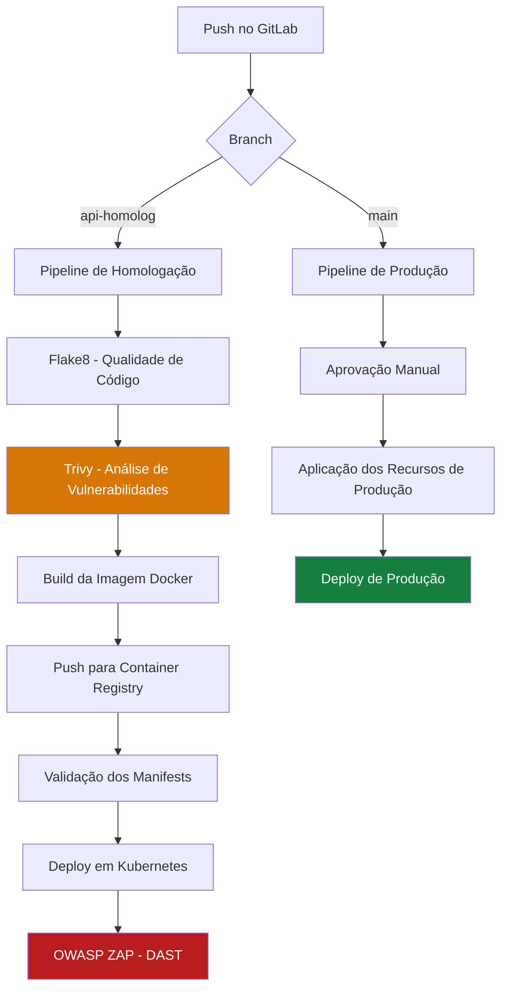

# 🚀 FastAPI DevSecOps — CI/CD com GitLab e Kubernetes

Projeto de automação de CI/CD para uma aplicação FastAPI, integrando práticas de DevSecOps, análise de vulnerabilidades, construção e publicação de imagens Docker, validação de manifests e deploy automatizado em Kubernetes.

O objetivo é demonstrar a implementação prática de um pipeline de entrega contínua com controles de qualidade e segurança, separação entre homologação e produção e automação do ciclo de entrega da aplicação.

## 🎯 Objetivos do projeto

- Automatizar o processo de integração e entrega contínua.
- Implementar análise estática de código Python.
- Identificar vulnerabilidades em arquivos e dependências da aplicação.
- Construir e publicar imagens Docker versionadas.
- Validar manifests Kubernetes antes da implantação.
- Automatizar o deploy da aplicação em Kubernetes.
- Executar testes dinâmicos de segurança com OWASP ZAP.
- Separar os fluxos de homologação e produção.
- Implementar controles manuais em etapas críticas do pipeline.

## 🏗️ Arquitetura do pipeline



O pipeline é organizado em dois fluxos principais:

- **Homologação:** análise do código, verificação de vulnerabilidades, build e publicação da imagem, validação dos manifests, deploy e testes dinâmicos de segurança.
- **Produção:** fluxo separado, acionado por push na branch `main`, com uma etapa manual antes da aplicação dos recursos de produção.

## 🛠️ Tecnologias utilizadas

| Tecnologia | Finalidade |
|---|---|
| Python 3.11 | Ambiente de execução e análise do código |
| FastAPI | Framework para desenvolvimento da API |
| GitLab CI/CD | Orquestração do pipeline |
| Flake8 | Análise estática e qualidade do código Python |
| Trivy | Análise de vulnerabilidades em arquivos e dependências |
| Docker | Construção e empacotamento da aplicação |
| GitLab Container Registry | Armazenamento das imagens de contêiner |
| Kubernetes | Orquestração e execução da aplicação |
| kubectl | Gerenciamento dos recursos Kubernetes |
| Kustomize | Aplicação de configurações Kubernetes |
| OWASP ZAP | Testes dinâmicos de segurança (DAST) |
| Mermaid | Documentação visual da arquitetura |

## ⚙️ Etapas do CI/CD

### 1. Análise de qualidade — Flake8

O job `test_code` executa o Flake8 sobre o arquivo principal da aplicação.

**Objetivos:**
- Identificar problemas de estilo e qualidade do código.
- Detectar possíveis erros e inconsistências.
- Estabelecer uma verificação inicial antes das próximas etapas.

A execução está configurada como manual no fluxo de homologação.

### 2. Análise de vulnerabilidades — Trivy

O job `library_scanner` executa o Trivy para analisar o diretório da aplicação.

Severidades configuradas:

- `HIGH`
- `CRITICAL`

A execução gera um relatório JSON, armazenado como artefato do GitLab CI/CD, inclusive quando o job falha.

O scanner utiliza um código de saída diferente de zero quando encontra vulnerabilidades correspondentes às severidades configuradas.

**Objetivo:** identificar vulnerabilidades conhecidas no conteúdo analisado antes da construção da imagem Docker.

> Observação: a configuração atual utiliza `trivy fs app/`. Isso não equivale a uma análise completa da imagem Docker final.

### 3. Construção da imagem Docker

O job `build_image` realiza a construção da imagem usando o Dockerfile do projeto.

A imagem local recebe uma tag baseada no identificador curto do commit:

```text
local:<commit-sha>
```

Esse modelo facilita a rastreabilidade entre o código-fonte e o artefato gerado.

### 4. Publicação no Container Registry

O job `push_image` marca a imagem e publica o artefato no registry configurado.

O padrão de nomenclatura utilizado é:

```text
<registry>/<namespace>/<aplicacao>:<commit-sha>
```

O uso de tags vinculadas ao commit facilita a identificação da versão publicada e a investigação de problemas em implantações.

As credenciais de acesso devem ser armazenadas em variáveis protegidas do GitLab CI/CD, nunca diretamente no repositório.

### 5. Validação dos manifests Kubernetes

O job `validate_manifests` utiliza o `kubectl` para realizar validações antes da implantação.

Os recursos contemplados incluem:

- ResourceQuota da aplicação.
- HTTPRoute para roteamento HTTP.
- Workloads da aplicação.
- Credenciais para acesso ao registry.
- Volumes e configurações relacionadas ao armazenamento.

A configuração atual utiliza `kubectl apply --dry-run=client`, que executa validações no cliente. Essa abordagem ajuda a identificar determinados problemas de configuração, mas não substitui a validação pelo API Server do Kubernetes.

### 6. Deploy automatizado em Kubernetes

O job `deploy_application` atualiza a referência da imagem e aplica os recursos Kubernetes utilizando Kustomize.

Fluxo de execução:

1. Identificação da imagem vinculada ao commit.
2. Atualização da tag no manifesto da aplicação.
3. Aplicação dos recursos definidos na configuração do ambiente.
4. Disponibilização da nova versão conforme o comportamento dos workloads Kubernetes.

Essa abordagem reduz intervenções manuais e facilita a rastreabilidade das versões implantadas.

### 7. Testes dinâmicos de segurança — OWASP ZAP

O job `dast_scan` executa o OWASP ZAP Baseline contra a aplicação implantada em homologação.

O objetivo é identificar possíveis problemas de segurança observáveis por meio de requisições HTTP à aplicação em execução.

O pipeline aguarda um intervalo após o deploy antes de iniciar o scanner.

**Importante:** o job está configurado com `allow_failure: true`. Portanto, falhas no DAST não bloqueiam necessariamente o pipeline. O ZAP Baseline também não substitui um teste de invasão completo.

### 8. Fluxo de produção

O fluxo de produção é acionado por push na branch `main`.

O job `check_manifests_prod` está configurado para execução manual e aplica os recursos Kubernetes definidos em `manifests-prod/`.

Após o sucesso dessa etapa, o job `deploy_prod` executa a aplicação da configuração de produção via Kustomize.

Esse fluxo introduz um ponto de controle manual antes das alterações no ambiente produtivo.

Para garantir a integridade da entrega, o fluxo deve assegurar que a imagem implantada em produção corresponda exatamente ao artefato aprovado e publicado anteriormente.

## 📂 Estrutura do repositório

Estrutura ilustrativa baseada nos caminhos encontrados no pipeline:

```text
.
├── app/
│   ├── app.py
│   └── requirements.txt
├── manifests/
│   ├── application-quota.yaml
│   ├── http-route.yaml
│   ├── myapp.yaml
│   ├── repo-secret.yaml
│   └── volumes.yaml
├── manifests-prod/
│   ├── db-access.yaml
│   ├── httproute.yaml
│   ├── repo-secret.yaml
│   ├── volumes.yaml
│   └── myapp.yaml
├── Dockerfile
├── .gitlab-ci.yml
└── README.md
```

A estrutura deve ser ajustada caso os diretórios ou arquivos reais do repositório sejam diferentes.

## 🔐 Configuração de variáveis no GitLab

Configure as variáveis necessárias em:

**GitLab → Settings → CI/CD → Variables**

| Variável | Finalidade |
|---|---|
| `REPOLABPASS` | Senha ou token de acesso ao Container Registry |
| `KUBENEXT` | Conteúdo da configuração de acesso ao Kubernetes |

O usuário do registry está definido diretamente no YAML atual. Como melhoria, ele também pode ser transferido para uma variável de CI/CD.

**Boas práticas de segurança:**

- Utilizar variáveis mascaradas e protegidas quando aplicável.
- Restringir credenciais de produção a branches e ambientes autorizados.
- Utilizar contas de serviço Kubernetes com privilégios mínimos.
- Evitar a exposição de tokens e arquivos kubeconfig nos logs.
- Não versionar credenciais, chaves privadas ou senhas.
- Separar as permissões de homologação das permissões de produção.

## 📋 Pré-requisitos

Para reproduzir o ambiente, são necessários:

- Projeto GitLab com CI/CD habilitado.
- GitLab Runners configurados com as tags e os ambientes de execução utilizados pelo pipeline.
- Runner com capacidade de executar builds Docker.
- Container Registry acessível pelo ambiente de build.
- Cluster Kubernetes com permissões para aplicar os recursos necessários.
- Configuração de acesso ao cluster disponibilizada de forma segura.
- Código-fonte da aplicação e arquivo de dependências.
- Dockerfile e manifests Kubernetes.
- Configuração Kustomize válida para os diretórios utilizados no deploy.

## ▶️ Como executar

### Homologação

Envie alterações para a branch `api-homolog`:

```bash
git checkout api-homolog
git add .
git commit -m "Atualiza aplicação"
git push origin api-homolog
```

O GitLab identificará a branch e iniciará o fluxo de homologação conforme as regras do pipeline.

O job de qualidade está configurado como manual. As etapas seguintes dependem das regras e das dependências definidas no YAML.

### Produção

Envie a versão aprovada para a branch `main`:

```bash
git checkout main
git merge api-homolog
git push origin main
```

O GitLab iniciará o fluxo de produção, que inclui uma etapa manual para aplicar os recursos produtivos.

Antes de utilizar esse procedimento em um ambiente real, estabeleça políticas adequadas de revisão, autorização, testes, rastreabilidade e rollback.

## 🛡️ Práticas de DevSecOps implementadas

O projeto integra diferentes controles ao ciclo de entrega:

- **Qualidade de código:** análise inicial com Flake8.
- **Análise de vulnerabilidades:** verificação com Trivy.
- **Containerização:** empacotamento da aplicação com Docker.
- **Rastreabilidade:** tags de imagem vinculadas ao commit.
- **Validação de configuração:** verificações de manifests Kubernetes.
- **Segurança dinâmica:** análise HTTP com OWASP ZAP.
- **Controle de produção:** etapa manual antes da aplicação de recursos produtivos.
- **Automação de deploy:** aplicação de configurações Kubernetes pelo pipeline.

## 🚧 Melhorias futuras

Algumas evoluções recomendadas para fortalecer a segurança e a confiabilidade do pipeline:

- Adicionar testes automatizados unitários e de integração com pytest.
- Publicar relatórios de testes e cobertura.
- Incluir análise estática de segurança (SAST) dedicada.
- Adicionar detecção de segredos no código-fonte.
- Executar scan Trivy sobre a imagem Docker construída.
- Gerar SBOM para cada versão publicada.
- Implementar políticas de bloqueio para vulnerabilidades críticas.
- Promover o mesmo artefato imutável de homologação para produção.
- Validar manifests também no API Server Kubernetes.
- Adicionar verificações de saúde após o deploy.
- Implementar estratégias de rollback.
- Configurar ambientes protegidos e políticas formais de aprovação.
- Separar credenciais e permissões por ambiente.

## 📌 Considerações finais

Este projeto demonstra a aplicação prática de automação de CI/CD e princípios de DevSecOps, integrando ferramentas de qualidade, análise de vulnerabilidades, containerização, orquestração e testes dinâmicos de segurança.

A proposta é evoluir continuamente o processo de entrega, buscando maior rastreabilidade, repetibilidade, segurança e confiabilidade operacional.

**Tecnologias principais:** Python · FastAPI · GitLab CI/CD · Docker · Kubernetes · Trivy · OWASP ZAP

---

*Projeto desenvolvido para fins de estudo, experimentação e demonstração de práticas de automação, infraestrutura e segurança no ciclo de entrega de aplicações.*
